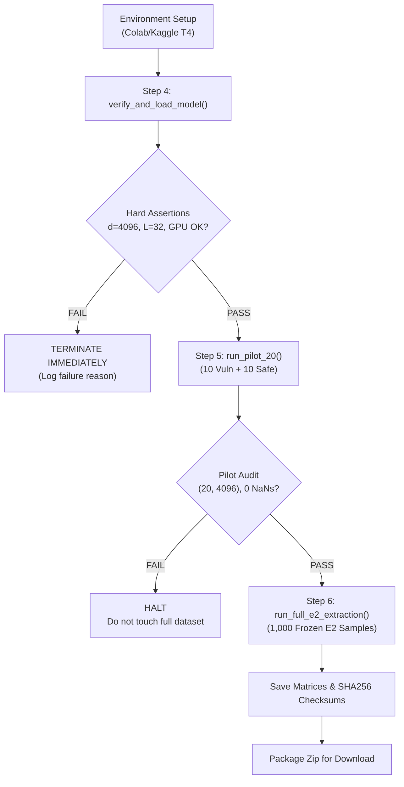

# Probe V3: Full Pretrained Mistral-7B Model Verification Protocol

**Date:** 2026-11-03  
**Project:** SQL Injection Security Probe V3 (CWE-89)  
**Target Model:** `mistralai/Mistral-7B-Instruct-v0.3`  
**Target Hardware:** NVIDIA Tesla T4 GPU (Google Colab / Kaggle)  
**Status:** Pre-Execution Verification Protocol & Audit Specification  

---

## 1. Executive Protocol & Hard Assertions

To eliminate the miniature model fixture ($d=128$) and mock mode from all future research claims, Probe V3 enforces programmatic hard assertions prior to extracting representations.

### Hard Assertions Enforced:
1. **Model ID:** Must be exactly `mistralai/Mistral-7B-Instruct-v0.3` (revision `main`).
2. **Hidden Dimension ($d$):** Must equal exactly **4,096**.
3. **Transformer Layers:** Must equal exactly **32**.
4. **Mock Mode Disabled:** `mock=False`. No miniature fixtures, synthetic activations, or randomly initialized weights.
5. **Pretrained Weights Loaded:** Real pretrained tensor weights loaded via 4-bit NF4 (`bitsandbytes`) with `device_map="auto"`.
6. **Real Forward Pass Verification:** A test forward pass must produce 33 hidden-state tensors (Index 0 = word embeddings, Indices 1–32 = Transformer layers 1–32), with shape `(1, seq_len, 4096)`, containing zero NaNs and zero Infs.

*Failure Rule:* If any hard assertion fails, execution immediately terminates with a non-zero exit code.

---

## 2. Model Architecture & Exact Parameter Accounting

Verified against the official Hugging Face configuration:

| Architectural Parameter | Verified Value | Functional Role in Probe V3 |
| :--- | :--- | :--- |
| **Model Type** | `mistral` | Causal Autoregressive Language Model |
| **Hidden Size ($d$)** | **4,096** | Dimension of probed residual stream representations |
| **Transformer Layers** | **32** | Probing candidate sweep: `[4, 8, 12, 16, 20, 24, 28, 32]` |
| **Reference Layer** | **Layer 16** | Midpoint representation before next-token specialization |
| **Query Attention Heads** | 32 | Head dimension $d_k = 128$ ($32 \times 128 = 4,096$) |
| **Key-Value Heads** | 8 | Grouped Query Attention (GQA, 4:1 query-to-KV ratio) |
| **Intermediate Size (FFN)** | 14,336 | SwiGLU projection dimension |
| **Vocabulary Size** | 32,768 | Byte-Pair Encoding subword vocabulary |
| **Exact Parameter Count** | **7,248,023,552** | ~7.25 Billion parameters |

---

## 3. Hardware & Quantization Specification

### Quantization Configuration:
- **Engine:** `bitsandbytes` 4-bit NF4 (`BitsAndBytesConfig`)
- **Quantization Type:** NormalFloat4 (`nf4`)
- **Double Quantization:** Enabled (`bnb_4bit_use_double_quant=True`)
- **Compute Dtype:** `torch.bfloat16`
- **Device Map:** `"auto"` (placed onto active CUDA GPU)

### Estimated Hardware Requirements (NVIDIA T4):
- **Base Model Weights in VRAM:** **~4.88 GB**
- **Peak VRAM during Batch Size 8 Inference:** **~6.04 GB** (Leaves ~9.0 GB headroom on 15.0 GB T4)
- **Host System RAM Required:** $\ge 6.0\text{ GB}$ (Kaggle/Colab provides 12.7–13.0 GB)
- **Disk Space Required for Shards:** **~15.0 GB** in `/root/.cache/huggingface/hub/`

---

## 4. Execution Gate Flowchart

---

## 5. Pre-Execution Verification Checklist

Before executing `kaggle_colab_t4_pilot.py` on Kaggle/Colab, verify:
- [ ] Active runtime is set to **T4 GPU** (`torch.cuda.is_available() == True`).
- [ ] `bitsandbytes` compiles and runs a 4-bit forward pass on CUDA.
- [ ] `data/e2_pilot_20.jsonl` contains exactly 10 vulnerable and 10 safe records.
- [ ] `data/e2_excel/` contains `train.jsonl` (700), `val.jsonl` (149), and `test.jsonl` (151).
- [ ] Checksums of split manifests match the Probe V2 freeze.
- [ ] External 700-sample benchmark is completely excluded.

